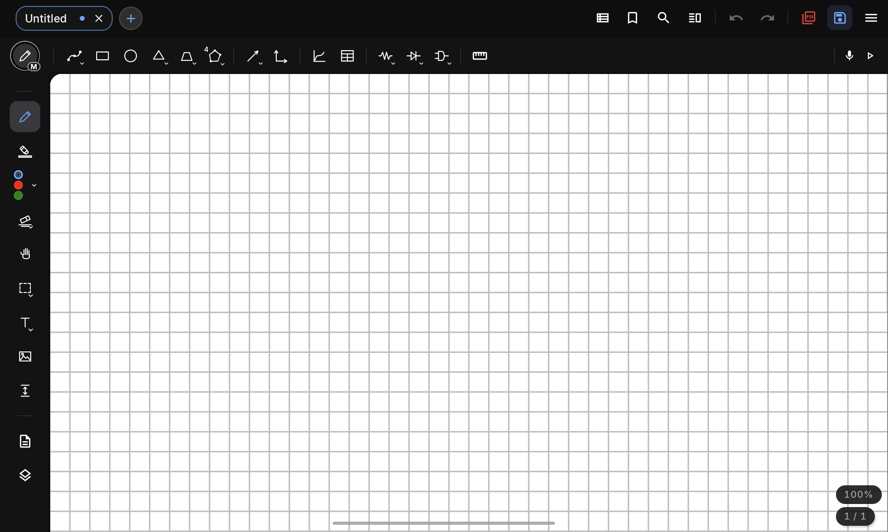
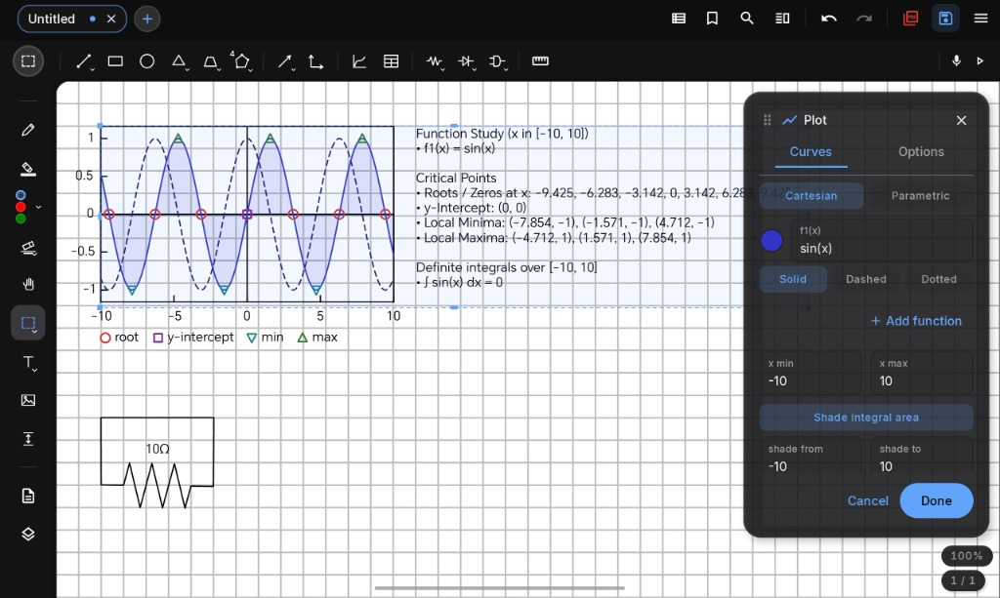
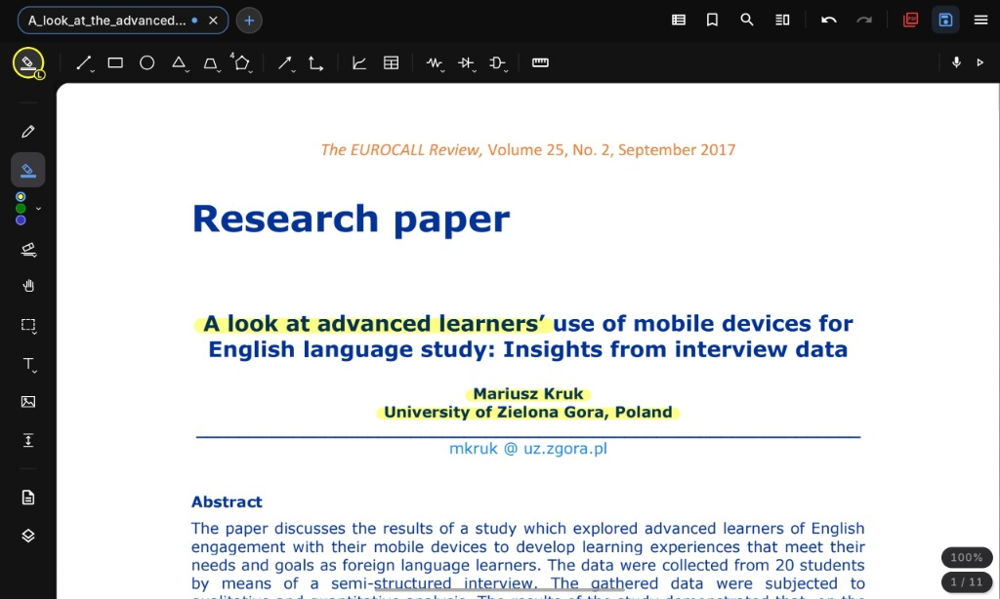
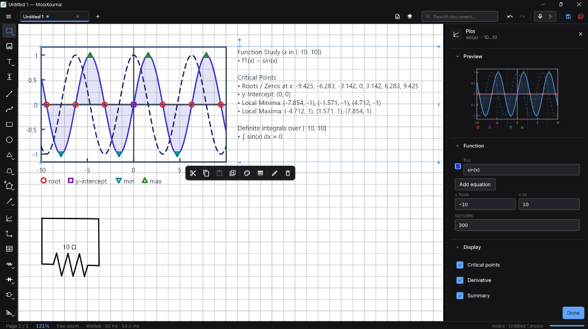

<div align="center">


# MobiXournal

### Think in ink. Keep every diagram, plot, and circuit alive.

[](https://github.com/amarzano2005/MobiXournal/releases)
[](#get-started-in-30-seconds)
[](https://github.com/amarzano2005/MobiXournal/actions/workflows/build.yml)
[](LICENSE)

<a href="https://github.com/amarzano2005/MobiXournal/releases/latest">
  
</a>
<a href="https://apps.obtainium.imranr.dev/redirect?r=obtainium://add/https://github.com/amarzano2005/MobiXournal">
  
</a>

[Android Setup](docs/guide-install-android.md) · [Windows 11 Setup](docs/guide-install-windows.md) · [User Guide](docs/guide-index.md) · [Changelog](docs/releases/index.md)



</div>

## Why MobiXournal?

> Most note-taking apps flatten diagrams into dead pixels. **MobiXournal** keeps your strokes, PDFs, function plots, circuits, matrices, and study cards editable — on **Android** and **Windows 11**.

<table>
  <tr>
    <td width="50%" valign="top">
      <b>Real Stylus Ink</b><br/>
      Pressure-sensitive pen, highlighter, ruler, and shape snap with smooth zoom from overview to fine detail. Palm rejection and stylus hover out of the box.
    </td>
    <td width="50%" valign="top">
      <b>Living STEM Elements</b><br/>
      Interactive function plots, parametric curves, circuit schematics, matrices, constrained geometry, scientific text (Typst &amp; LaTeX), code blocks, measurements, and study flashcards.
    </td>
  </tr>
  <tr>
    <td width="50%" valign="top">
      <b>PDFs, Bookmarks &amp; Audio</b><br/>
      Annotate multi-page PDFs with embedded or linked backgrounds, keep table-of-contents bookmarks, and record time-synced voice notes during lectures.
    </td>
    <td width="50%" valign="top">
      <b>Offline Search &amp; Two Shells</b><br/>
      Full-text search across typed notes, LaTeX, and OCR'd handwriting. Native Jetpack Compose Android app and Compose Desktop Windows 11 app powered by a shared core.
    </td>
  </tr>
</table>

## See it in action

<table>
  <tr>
    <td align="center" width="50%">
      <br/>
      <sub><b>Interactive Plots &amp; Geometry</b> — edit equations and axes directly on the page</sub>
    </td>
    <td align="center" width="50%">
      <br/>
      <sub><b>PDF Annotation &amp; Voice Notes</b> — ink, highlight, and jump by bookmark</sub>
    </td>
  </tr>
  <tr>
    <td colspan="2" align="center">
      <br/>
      <sub><b>Windows 11 Desktop</b> — native window with the same <code>.mobix</code> and <code>.xopp</code> documents</sub>
    </td>
  </tr>
</table>

## Two open formats — zero lock-in

| Format | Best for | Compatibility |
|---|---|---|
| **`.mobix`** *(native)* | Full MobiXournal notebooks, living STEM elements, study decks, and optional embedded PDFs & audio | Native ZIP container with readable JSON + assets |
| **`.xopp`** *(Xournal++)* | Sharing notebooks with desktop Xournal++ users | Lossless bidirectional `.xopp` open and save |

- **Embed PDF backgrounds**: toggle in Settings, Import PDF, or Save As to pack PDFs inside `.mobix` for self-contained sharing, or keep them linked (on Windows, the window refuses to rewrite a packaged `.xopp` whose background lives only inside that archive).
- **Never converts silently**: opening a `.xopp` file keeps it in `.xopp` until you explicitly use **Save As**. See [Formats & Conversion](docs/guide-formats-and-conversion.md), [Xournal++ Migration](docs/guide-xournalpp-migration.md), and [Capabilities & Limitations](docs/guide-limitations.md).

## Get started in 30 seconds

| Platform | How to install |
|---|---|
| **Android 8.0+** | Download the signed `MobiXournal-<version>.apk` from [GitHub Releases](https://github.com/amarzano2005/MobiXournal/releases/latest) (or track updates via [Obtainium](https://apps.obtainium.imranr.dev/redirect?r=obtainium://add/https://github.com/amarzano2005/MobiXournal)). See [Android Setup](docs/guide-install-android.md). |
| **Windows 11 (64-bit)** | Download `MobiXournal-<version>.msi` from [GitHub Releases](https://github.com/amarzano2005/MobiXournal/releases/latest) and run the installer — no separate JDK required. See [Windows 11 Setup](docs/guide-install-windows.md). |

## Documentation

| Guide | What you'll find |
|---|---|
| [**User Guide**](docs/guide-index.md) | Pens, layers, living STEM elements, PDFs, audio notes, search, and sync |
| [**Capabilities & Limitations**](docs/guide-limitations.md) | Honest parity matrix between Android and Windows 11 |
| [**Troubleshooting**](docs/guide-troubleshooting.md) | Stylus input, PDF embedding, export errors, and recovery |
| [**Release History**](docs/releases/index.md) | Versioned release notes and upgrade highlights |

<details>
<summary><b>Developers &amp; Contributors</b> — build from source, architecture &amp; licence</summary>

<br/>

```bash
# Run unit tests & documentation guards
sh scripts/host-build.sh :app:testDebugUnitTest

# Build the signed release APK
sh scripts/release-apk.sh

# Package the Windows 11 Desktop distributable
sh scripts/host-build.sh :desktop:createDistributable
```

- Start with the [Developer Guide](docs/developer-guide.md), [Architecture Index](docs/architecture.md), and [Contributing Guide](CONTRIBUTING.md).
- Documentation workflow & quality checks live in [Writing Docs](docs/writing-docs.md) and [Doc Governance](docs/doc-governance.md).
- Coding rules and design workflow are in [AGENTS.md](AGENTS.md) and [Design Workflow](docs/design-workflow.md).
- **Licence & Lineage**: MobiXournal is an independent, unofficial app distributed under [GPL-2.0](LICENSE) (project documentation under CC0-1.0); it is not affiliated with or endorsed by Xournal++.

</details>
