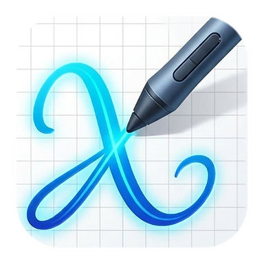
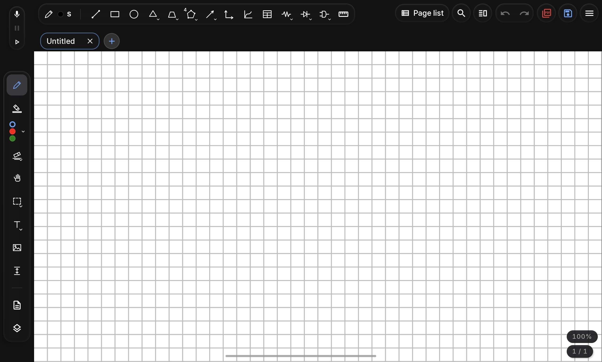
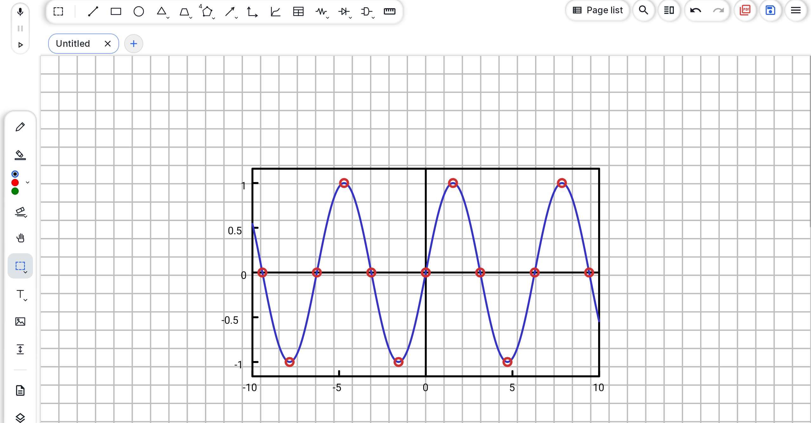
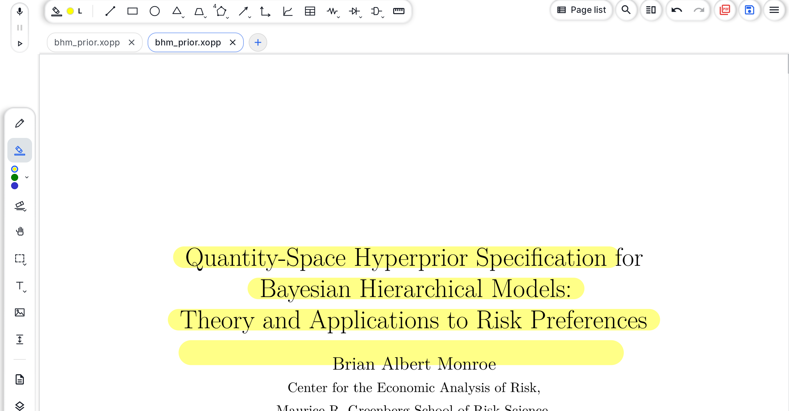
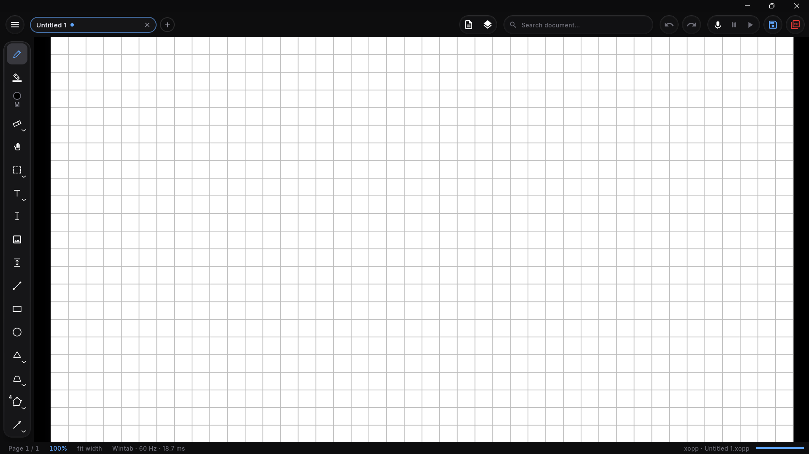

# MobiXournal

### Think. Write. Explore.

**A handwriting-first scientific workspace for Android and Windows.**

*Handwritten ideas, mathematics, scientific tools and document workflows in one workspace — for students, educators and technical readers.*

[**Install on Android**](docs/guide-install-android.md) · [**Install on Windows 11**](docs/guide-install-windows.md) · [**User guide**](docs/guide-index.md) · [**Releases**](https://github.com/amarzano2005/MobiXournal/releases)

*One page holding handwriting, figures and a document — the editor on an Android tablet.*

---

## The idea behind the workspace

A notebook app treats the page as a picture and a drafting tool treats it as a canvas. MobiXournal treats it as
working paper: what you place stays an object you can reopen and change.

It is built for people who think in handwriting and need mathematics, diagrams and source documents beside
it — a student on a problem set, an educator preparing one, an engineer sketching a circuit, a researcher
annotating a paper. Files stay yours, in the folder you choose, with no account between.

## What the workspace is made of

### Think and write

- **Ink that answers the pen.** Width follows the pressure the tablet reports, through the same filter desktop Xournal++ uses: a thin fast stroke and a bold pressed one are one gesture.
- **The pen outranks the toolbar.** A palm that landed first is abandoned when the stylus arrives, a flipped eraser erases, and the barrel button runs the action you pick.
- **Shapes from ink.** Rest the tip for a third of a second and a line, circle or arrow snaps clean; a closed triangle or rectangle stays a shape with movable corners.
- **Paper belongs to the page.** Plain, ruled, dotted, graph or isometric ruling, with the sheet's size chosen separately.

### Mathematics, engineering and science

#### Mathematics

- **Functions you can feel.** A plot keeps its formula live: its named parameters get sliders, and dragging one re-evaluates curve, derivative and summary.
- **Analysis in the same place.** Critical points, inflections, a shaded integral and a written summary belong to the plot, not a separated calculator.
- **Formulas and curves.** LaTeX takes a live typeset preview; a parametric or polar curve is stored, drawn and exported, though the plot tool places Cartesian curves only.

#### Engineering and logic

- **Objects, not pictures.** A table keeps a header row and real cells a typo edits rather than repaints; circuits wire together at a part's pins.
- **Drawings that snap.** Drafting guides snap a 15° protractor, a 60° lattice and the page's grid, so a sketch keeps its geometry.

#### Documents and research

- **Write on the source.** A PDF becomes the page's background — by range, replacing or appended — and its text stays selectable and copyable.
- **A highlighter that finds the line.** Drag across PDF text and each line snaps into a constant-width band; a margin mark stays exactly as drawn.
- **Follow the document's contents.** A PDF's outline opens as a tree by its own page numbers, even after two files merge.
- **Record while you write.** Tap a stroke to replay its recording. Bundled audio and waveforms load in the background.
- **Search everything at once.** Typed text, PDF text, formula source and your handwriting come back offline — on Windows, and on the tablet once its model downloads.

### One workspace, two shells

- **The same notebook, two surfaces.** One file and one core behind two working surfaces: the tablet built around a pen in hand, the window around tabs, panels and export; where the tools differ, [the limitations page](docs/guide-limitations.md) says so.
- **The window is a workstation.** Tabs that keep their own page and zoom, a sidebar of thumbnails and layers, and export to PDF, PNG or SVG.
- **The tablet is the paper.** Split view, the Ring at the pen, palm rejection, and pages sized for a hand.
- **Nothing converts behind your back.** A document keeps the format it was opened in; nothing needs an account or a connection.

## Screens from the real app

  

  *A function placed on the page, still an editable object.*

  

  *An imported PDF, highlighted line by line.*

  

  *Handwritten derivations in the Windows 11 window.*

## Platforms, and what each one needs

| Platform | What you need, and what you get |
|---|---|
| **Android 8.0 or newer** | The release APK from [GitHub Releases](https://github.com/amarzano2005/MobiXournal/releases). A stylus makes it a notebook; a finger does the rest. |
| **Windows 11, 64-bit** | A per-user installer, with no Java to install first and a folder build that needs no install. |

The shells number separately; [the release index](docs/releases/index.md) records both. The installer is **unsigned**: Windows reports an unknown publisher and SmartScreen may ask
first, which is deliberate rather than a false identity.

## The two file formats

| Format | What it is for |
|---|---|
| **`.mobix`** | MobiXournal's own container: one self-contained file that keeps plots, tables, circuits, formulas, audio and full stylus telemetry editable, and opens a long notebook page by page. |
| **`.xopp`** | The interchange format desktop Xournal++ reads and writes. On export a plot, table or circuit becomes standard ink, with a metadata block that lets MobiXournal restore it while that ink is unchanged. |

Opening preserves the format. **Save As** changes it after a successful save; cancelling leaves the original unchanged.
An untouched file returns the same XML; interchange limits affect telemetry and flattened objects' editability. The Windows window **refuses**
one **packaged** `.xopp` whose background lives inside it, leaving the file untouched. Details: [the native
format](docs/mobix-format.md), [the `.xopp` contract](docs/xopp-bridge.md), [which format your notebook is
in](docs/guide-formats-and-conversion.md).

## Installing, and the first notebook

**Android**

1. Download `app-release.apk` from [GitHub Releases](https://github.com/amarzano2005/MobiXournal/releases) and open it.
2. Allow installs from the app you downloaded it with; the permission can be turned off afterwards.
3. Notebooks are files you pick with Android's own dialog.

**Windows 11**

1. Download `MobiXournal-<version>.msi` from [GitHub Releases](https://github.com/amarzano2005/MobiXournal/releases) and run it.
2. Confirm the SmartScreen prompt if one appears, and keep or decline the associations and shortcut.
3. Open a notebook from the header, from Explorer, or by dragging a file onto the window.

Desktop settings use task groups; graph previews follow the theme. Windows saves briefly suspend editing while running in the background.

A new tab is empty until saved: **Save As** names it and fixes its format; **Save** writes back there.
Recents show what you opened — **×** drops one — and **Restore last session** reopens an unfinished session.

## Where the work stands today

Most of what the sections above describe is settled and in daily use.

Some of it stops part-way: a Typst source is kept but not typeset, and tablet handwriting search needs its model
downloaded before it answers. Absent: no sync between devices, tilt does not change stroke width, and the
chemistry palette is gone. Shell differences: [what works, and what is not there](docs/guide-limitations.md).

## Documentation, by question

| If you want to | Read |
|---|---|
| use the app, task by task | [the user guide](docs/guide-index.md) |
| know what works on which platform | [what works, and what is not there](docs/guide-limitations.md) |
| get past a failure, or recover a notebook | [when something goes wrong](docs/guide-troubleshooting.md) |
| know which version shipped, and what it changed | [the release index](docs/releases/index.md) |
| understand how the system is built | [the index of owners](docs/architecture.md) |
| follow the rules these pages obey | [the writing standard](docs/writing-docs.md) and [governance](docs/doc-governance.md) |

## Building from source, and getting involved

`scripts/build.sh` with `/data/android`, `scripts/host-build.sh` anywhere else; suites, guards and releases are
[the developer guide](docs/developer-guide.md)'s. A report or patch starts at [CONTRIBUTING.md](CONTRIBUTING.md).

## Licence, credit and lineage

**GPL-2.0-or-later** — [LICENSE](LICENSE), with third-party notices in [NOTICE](NOTICE). MobiXournal continues
Brian Monroe's [NeXopp](https://github.com/bamonroe/NeXopp) and shares its formats with
[Xournal++](https://github.com/xournalpp/xournalpp). It is independent, not affiliated with or endorsed by the
Xournal++ authors.
