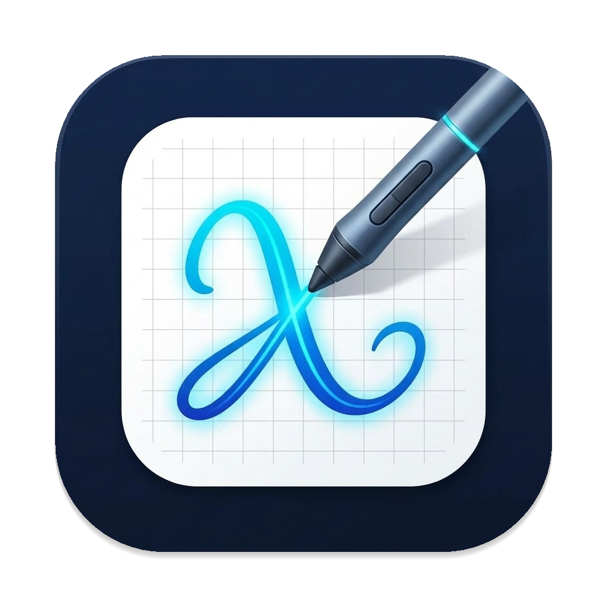
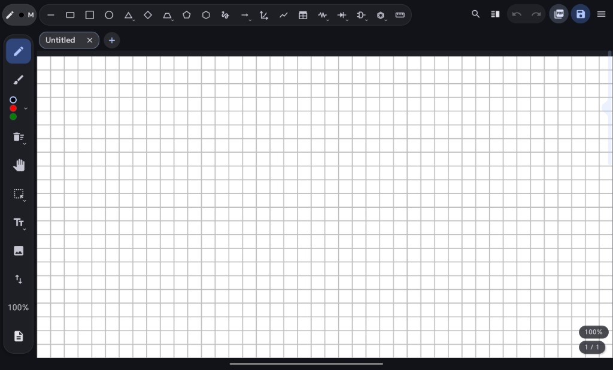

<div align="center">
  

  # MobiXournal
  **A stylus-first Xournal++ (`.xopp`) editor & STEM companion for Android — with full graphics tablet support & ExpressKey shortcuts**

  [](https://github.com/amarzano2005/MobiXournal/actions/workflows/build.yml)
  [](LICENSE)
  [](https://android.com)
  [-orange)](https://github.com/xournalpp/xournalpp)
  []()

  <br />

  
</div>

**MobiXournal** is an open-source Android app designed for handwritten notes, sketching, and technical documentation using the native [Xournal++](https://github.com/xournalpp/xournalpp) (`.xopp`) format, with first-class support for active styluses, graphics tablets (Wacom, Huion, XP-Pen), and configurable hardware shortcuts.

The primary goal is **100% format fidelity and round-trip safety**: files edited on Android reopen identically in desktop Xournal++ on Linux, macOS, or Windows without losing strokes, layers, backgrounds, or metadata.

In addition to core note-taking, MobiXournal features a specialized **STEM toolset** (electronic circuits, IEEE logic gates, relational schema tables, coordinate systems, parametric splines, virtual drafting instruments, and on-device LaTeX rendering) saved as standard vector strokes.

> **Credits & License**:
> - **Xournal++**: Format handling, palette, and shape recognition are derived from or matched to [Xournal++](https://github.com/xournalpp/xournalpp) (GPL-2.0-or-later).
> - **NeXopp**: MobiXournal is a continuation and rebranding of [NeXopp](https://github.com/bamonroe/NeXopp) by Brian Monroe (`bamonroe`).
> - This project is independent and unofficial, distributed under the **GPL-2.0-or-later** license. See [`LICENSE`](LICENSE) and [`NOTICE`](NOTICE).

---

## ▶️ Try it

| What | How |
|---|---|
| **Android app** | Download `app-debug.apk` from the latest [GitHub Release](https://github.com/amarzano2005/MobiXournal/releases), or build it with `.\gradlew.bat assembleDebug` — the APK lands in `app/build/outputs/apk/debug/`. It installs as **MobiXournal v2 (dev)**, next to the daily app rather than over it. |
| **Desktop app (Windows 11)** | Build it with `.\gradlew.bat :desktop:createDistributable`, then run `desktop/build/compose/binaries/main/app/MobiXournal/MobiXournal.exe` (add a file path to open a document; `udiff.xopp` in this repository is a good first one). It is a self-contained folder with no installer, unsigned, and read-only for now. See *Desktop preview* below. |

Both builds need a JDK 21 and, for the APK, the Android SDK — see *Build & Requirements* below.

---

## 📚 Documentation Map

MobiXournal follows a hub-and-spoke documentation model:

| Topic | Document |
|---|---|
| **Development & Conventions** | [`AGENTS.md`](AGENTS.md) |
| **System Architecture** (the index of the spokes) | [`docs/architecture.md`](docs/architecture.md) |
| **UI contract** (what a new interface element must satisfy) | [`docs/interface-contract.md`](docs/interface-contract.md) |
| **The native `.mobix` format** | [`docs/mobix-format.md`](docs/mobix-format.md) |
| **The desktop app** | [`docs/desktop-workstation.md`](docs/desktop-workstation.md) |
| **The `.xopp` on-disk schema** | [`docs/xopp-format.md`](docs/xopp-format.md) |
| **Build Tools, Container & Emulator** | [`docs/tools.md`](docs/tools.md) |
| **Active tasks** | [`TODO.toml`](TODO.toml) (via `scripts/todo.sh list`) |
| **Completed Work Archive** | [`FINISHED.toml`](FINISHED.toml) |
| **Release Notes (per version)** | [`docs/releases/`](docs/releases/) |

---

## 🛠️ Build & Requirements

### Requirements
- **Linux container host**: Docker (all builds run in a containerized Android toolchain; no local JDK, SDK, or Gradle needed) and, optionally, KVM for headless emulator testing.
- **Windows 11 (or any host without `/data/android`)**: a JDK 21 and the Android SDK, driven by `.\gradlew.bat` (the desktop app alone needs only the JDK).

Without Docker (or on a machine with no `/data/android` toolchain) the same build runs on the host's
Gradle wrapper, which needs a **JDK the wrapper supports** (17–24 for the version in the tree — a
JDK 25 host fails before compiling anything) and an Android SDK at `local.properties`' `sdk.dir`.
`scripts/host-build.sh` finds both for you (and reports them with `--list`) instead of leaving it to
the wrapper's own confusing failure. See
[Host fallback](docs/tools.md#host-fallback--no-dataandroid-no-docker) in `docs/tools.md`.

### Build Commands
```sh
# Full build: unit tests + debug APK
scripts/build.sh

# Run JVM unit tests only (instant, no device needed)
scripts/build.sh testDebugUnitTest

# Clean release-path build of the debug APK
scripts/build.sh clean assembleDebug
```

On a host with no `/data/android` and no Docker, `scripts/host-build.sh` is the same loop with the
JDK/SDK discovery done for you (`--list` reports what it picked, `--jdk`/`--sdk` override it):

```sh
# Host fallback: finds a supported JDK + the SDK, then runs the wrapper
scripts/host-build.sh

# Any Gradle task passes through — including the instrumented suite, on the host's own adb
scripts/host-build.sh connectedDebugAndroidTest
```
For emulator installation, deployment, and testing harnesses, refer to [`docs/tools.md`](docs/tools.md). Cutting a release is documented there too, and it is a command rather than a chore: `scripts/todo.sh release --version <version> --bump-gradle` stamps everything finished since the last release and drafts `docs/releases/v<version>.md` from it, then you curate that draft and push the `v<version>` tag so CI builds the APK and publishes the Release.

### 🖥️ Desktop preview (experimental)

The desktop app is in the tree: a native window that opens your
documents and shows every page as it was written — paper ruling, pen strokes with their pressure taper,
highlighters, dashed lines, text boxes, and the living parts of a page too: tables, graphs, parametric
shapes, circuit components and our formulas, plus photo and annotated-PDF page backgrounds — with zoom. A standard `.xopp`, a single-file `.xopp` package and a native
`.mobix` all open, and the window works out which one it has from the file's content rather than its
name. A long `.mobix` notebook opens instantly and reads pages as you scroll, instead of loading every
page up front.

The window wears the app's own frosted-glass chrome over a black desk, with the same Inter typeface and
the same Material text scale as the tablet — the picker panel grows in and draws back on the same spring
the tablet's panels use. Its
Windows title bar is painted in the same band colour as the header, so the window reads as one surface
from the caption down instead of a light system bar sitting on a dark app, and the document tabs are the
same glass capsules as the rest of the chrome, the active one wearing the family's edge. The window wears the
app's own icon on the taskbar, where the JVM's coffee cup used to be — the tablet's launcher art with its
navy field dropped, so the sheet and the pen are the whole mark — while the title bar above the header
carries no app name, no logo and no second icon: **the caption is the tabs alone**, and the art stays on
the taskbar where it belongs. A **hamburger** in the header opens New, Open, Save, Save
As and the sidebar toggle, the strip's **`+`** starts a new page, and a window that opens without a file
opens one too, instead of an empty notice. The toolbars are
the tablet's too: the same raised glass capsules floating in their own lanes, and the same monoline tool
icons, down to the picked slot's shape. More than one document can be open, each in its own tab that remembers the page and the
zoom you left it at. A collapsible sidebar lists the pages of the current document as thumbnails (and the current
page's layers, each with an eye that hides it from the page and from the thumbnail without touching the file),
and the page can be fitted to the window, fitted to its width, or zoomed freely, up to **3 200 %** — a
single glyph fills the window when you need to look that closely — and the point under the cursor stays
where it is while you zoom. A page saved as one long strip — how a lecture
written to the bottom of the sheet comes out of the tablet — opens fitted to its width instead of being
shrunk to a sliver, so the handwriting stays readable and the wheel reads down it. You can **write on the
page** with the pen and the highlighter and **rub ink out** with the eraser — the stroke appears as you
draw and lands in the document when you lift, and `Ctrl + Z` takes it back (with `Ctrl + Shift + Z` to
put it again). The eraser has its two members as two slots: `E` cuts the ink it crosses, `Shift + E`
takes whole strokes. **Type on it** with Text (`X`): a press opens a box where you pressed, `Enter` starts
a new line, and `Esc` or a click elsewhere commits it as one edit — ink and typing undo the same way.
**Click words that are already on the page and you edit them**: the box comes up with your text, in its own
font, size and colour, and correcting it — or emptying it, which deletes the box — is one undo step, whether
the words were typed on the PC, on the tablet or in desktop Xournal++. What you type sits exactly where it
will land, on the bare page: no panel, just the caret. Select a box and press the pencil (or double-click it)
and the side column sets its **face** — Sans, Serif or Monospace, bold, italic — its **size** and its
**colour**, one undo step per change, the same five choices the tablet's text dialog offers. The pen and the highlighter keep **separate colours, widths and favourite colours**,
as on the tablet: dragging a yellow highlighter over a page leaves the pencil the colour it was, and
switching back brings that ink back with it, and each tool also remembers its **stroke pattern** — solid,
long dash, dash-dot or dotted — picked beside the colour. **Drag a figure** with Line, Arrow, Double arrow,
Axes, Rectangle, Ellipse or Spline — one drag, one stroke, `Shift` to snap the direction to 45°, `Esc` to
cancel — each of the seven a slot of its own, one click and no submenu, and a figure always draws in the
pen's ink even while the highlighter is the tool in hand, as on the tablet. While the Line tool or a
circuit family is armed, every **circuit pin** on the page wears a small dot, and the ends of what you draw
are **pulled onto the nearest pin**: a wire drawn near a terminal joins it, and a part dropped on one meets
it, so a circuit can be assembled rather than drawn near — a selected part keeps its pins marked, so you can
**pick the part up by its pin** and drag it onto another pin or onto the end of a line you have drawn there,
where it settles exactly. **Pan** with the **hand** (`G`): a drag
moves the page instead of drawing on it, and with the pen it follows the stylus at the tablet's own rate,
travelling further than the pen does so a flick of the wrist crosses the sheet — while every tool keeps its
own state meanwhile. The sheet itself is editable from the **toolbar**: its last three buttons, after a
divider, open **Page background** (the tablet's paper styles and 2, 3, 5, 7 or 10 mm ruling), **Page
format** — the A4/A5/Letter/Legal presets either way up, **any size you type** in millimetres, inches or
points with a swap button, and — on the same panel's last line — the **default for new pages**: the four
presets, **Use this size** to keep the sheet you just typed, and the size new pages will open at. Changing a
page is one undoable edit written in the file's own ruling parameter, while setting the default only
affects sheets that do not exist yet, so it never resizes the page under your ink. And **shift a page down**
with Vertical space (`Shift + V`), which moves everything below the line you drop and nothing the line
crosses. **Pick things up** with Marquee (`S`) or Lasso (`V`): a click on any element catches it where it
lies (one click on empty paper lets the selection go, and a double-click opens a living element's editor),
then drag the outline to move it, pull a corner to resize it or the handle above it to turn
it (`Shift` snaps the turn), and `Delete` takes it away — each drag one edit, one `Ctrl + Z`. `Esc` lets a
selection go. A bar appears under the outline with the tablet's own actions — cut, copy, paste, duplicate,
recolour or re-width what is caught, align and distribute a group, delete — and `Ctrl+C`/`Ctrl+X`/`Ctrl+V`/
`Ctrl+D` do the same from the keyboard; a paste lands beside what it copied and stays selected. The **pencil**
on that bar opens the selected table, plot, figure, component or formula in a lane beside the page, where its
own values are editable without a dialog ever covering the sheet. The lane opens **while you are editing**
and closes when you are done — `Esc`, the close glyph or `Done` — or as soon as you select something else, so
it never sits there as a panel you did not ask for. It is the same width every time, with a header naming the
element (its symbol and its formula, grid or value), grouped cards of fields, and one action at the bottom. A
graph's card leads with the **graph itself**, redrawn as you edit it, carries every equation it has with
**Add equation** and a remove glyph beside each row, and its display switches work right there — the same
preview the placement asked its questions with. **Every equation has its own colour**: a swatch sits beside
each formula, a new row arrives in the next palette ink instead of the same black as the one above it, and
the curve is drawn in the colour of its row — in the card before it is placed and in the lane afterwards,
because both write through the same builder. **Place** a graph or a table with Plot (`M`) or Table (`T`):
drag the box it should fill (or click for the default size), and the right-hand lane asks what the element
should be before it exists — the graph dialog's own questions for a plot (formula, domain, critical points,
derivative, summary, shaded area) or the table's columns, rows and header — so **Place** writes one live,
selected element and one `Ctrl + Z` puts the page back, while Cancel leaves the page untouched. A **circuit
component** (`K` passive parts, `Shift + K` active parts, `Alt + K` logic gates) is drawn instead of asked
about: the drag is the part — its **two ends** set its length *and* its angle, so a part drawn at 45° stands
at 45° and its ends settle on the pins in reach — its pins and body appearing on the sheet as the pen moves
and landing on the lift as one live, selected element, exactly as a figure behaves. A circuit slot opens the tablet's palette
of that family's symbols on a **second** click — the first only arms the slot, and the little chevron on
the slot opens the palette straight away — and the drawing is the pen's own colour and width. A slot that holds several tools works the same way: one click
picks the tool, a second click asks which of them. Once an element is placed the window switches to the
selection tool, as the tablet does, so the next drag moves what you just made instead of placing another.
**Type on the page** with Text (`X`): click where the line should start and a field opens there, in your ink's
colour and size, with the page still untouched — `Enter` starts a new line, and `Esc` (or a click somewhere
else) writes the box as one undoable edit. Type nothing and nothing is written, so a click you change your
mind about leaves no empty box and nothing to undo. Clicking **words already on the page** opens them for
editing instead (whatever wrote them — this window, the tablet, or desktop Xournal++), with their own font,
size and colour; clearing the text deletes the box, and both are one undo step. The Text slot's second member, **Formula** (`Shift + T`),
notes a formula instead: it asks for the LaTeX (or Typst) source, shows it typeset as you type, and **Place**
writes it as one live math block — the same element the tablet edits and the `.xopp` export understands.
A live element can also be shaped **where it sits**: a figure wears a ring on each corner and a table a ring
on each divider, so dragging one bends the figure or rewidens that column without touching a cell's text, and
a double-click on the element opens the card that edits it.
Dragging a selection, an element already on the page, a figure being drawn or a vertical-space line against
the **edge of the canvas scrolls the view** while the drag keeps going, and the scroll eases in and settles
rather than jumping: a marquee keeps catching ink past the border, a box or an arrow keeps opening, and an
element can be carried to a part of the sheet that is off screen without lifting the pen. A shape and a reflow are ordinary edits, so they round-trip through `.xopp` like ink, and `Ctrl + S` writes it back to the file you opened
(a `.xopp` stays a `.xopp`, a `.mobix` stays a `.mobix`), with `Ctrl + Shift + S` saving a copy under
the format its name asks for. The window speaks English, like the tablet app, and it is a separate
module, so it never affects the Android build.

The graphics tablet is read directly, through the tablet driver's own packet stream rather than the
desktop's mouse pointer, and the stroke itself begins and ends with that stream — so the pen behaves like
a pen: strokes taper with the pressure you actually apply, they start even from the lightest touch and
survive a pause in the middle of the line, the pen's tilt and the way you hold it travel with the ink, and
turning the pen round to its eraser end rubs out. The mouse the system emulates alongside the pen never
draws that line, so one touch is one stroke and never two. The ink is published once per screen frame rather
than once per driver packet, so a fast hand costs one redraw a frame instead of hundreds, and the window
asks for a frame only when the pen has something new to draw — a sheet nobody is writing on is not
repainted at all. Scrolling and zooming are just as cheap on a dense page: the sheet is recorded once at
document scale and moved by the canvas, so a wheel notch or a pinch costs a replay instead of a
re-render (0.2 ms a frame on this project's densest document, where it used to cost 3.6–4.3 ms). The line was measured against the nib (`--probe-ink`): a pen reading becomes ink in a
median 1.5–2.0 ms (5.2 ms p95) on a blank page and on this project's densest six-page document, so the
line lands on the very next frame your screen shows instead of the one after — at 144 Hz that is 6.9 ms,
and the status bar tells you the rate it found (`120 Hz · 8.3 ms frame`) beside the pen stream. A lift costs
one stroke, not the page: the sheet keeps a recorded base plus one picture per stroke since it, so writing
for a minute is as quick as the first letter. Over the page the pointer **is the tool's**: every tool that
marks the sheet — pen, highlighter, both erasers, every figure, a circuit, Text, vertical space, the
selection — wears a ring the size of the line it will write, and the desktop's arrow goes away while it
does, instead of sitting glued to the ring and pointing at nothing; only the **hand** carries the hand,
because it moves the page. The ring
adds the width and the exact point you are about to draw at. The ring is driven by the tablet's own readings rather than by the slower mouse
copy of them, so it sits under the nib instead of trailing it, and it keeps its place while you hold the
pen still above the page. The status bar says which stream the window has — `pen: Wintab`,
`pen: Windows Ink` or `pen: mouse` — and on `pen: mouse` the pen draws at the tool's width, because
nothing richer reached the window.

Turn the tablet's **rotary dial** to zoom — clockwise in, anticlockwise out, at the cursor, exactly as
`Ctrl` and the wheel do — while the mouse's wheel keeps scrolling the page: the window tells the two
apart by the device the notch came from, so neither takes the other's action. Pressing a dial that
Windows exposes as a radial controller returns to the page's fitted view; that one lists **MobiXournal**
among its tools (choose it there once if your tablet asks), and the status bar adds `dial` while it is
bound.

A tab with edits the file does not have yet shows a small blue dot beside its name. Closing it — the
`×`, `Ctrl + W`, or the window's own close button — asks first: **Save**, **Discard** or **Cancel**. If
the window is interrupted with unsaved work still open (a crash, a forced shutdown), those tabs come
back on the next start marked "recovered", and saving them writes the file they came from.

Isometric paper — the triangular ±30° sheet — is ruled here from the same geometry the tablet uses, so the
two shells draw the same grid.

The drawing tools have their two placements here as well: a vertical rail beside the page (the
default) and a horizontal ribbon under the header, each a rounded pane of glass with a little air around
it rather than a strip glued to the window's edge. The header's **Tool placement** control switches
between Rail, Ribbon or Both, and the choice is remembered the next time you start the app. Whichever
is on, the strip keeps its own lane and the page is never underneath it. Hovering a slot shows the
tool's name and its keyboard shortcut, and the shortcuts pick the tool without leaving the keyboard —
including while a flyout, a hover pill or a palette is open, because none of them takes the keyboard.
A slot can hold a **family**: the eraser slot holds both erasers and the figure slot holds the seven
figures, with a small chevron that opens the family's list — click it, click the slot again once it is
the tool in hand, right-click the slot, hold it, or press `Alt`+`Down`, and picking a row re-faces the slot. Nothing on the strip is a button that does
nothing: a tool the window cannot draw with yet is simply not shown.
The colour slot also carries the palette: pick a swatch, define your own colour in the window's HSV/hex panel, or add a new
one, and the palette, the favourites and the width are remembered between runs.

| Key | What it does |
|---|---|
| `Ctrl + T`, `+` in the strip | open a document (an already-open file jumps to its tab) |
| `Ctrl + S` / `Ctrl + Shift + S` | save back to the file, when it has unsaved edits / Save As (the name's suffix picks the format) |
| `Ctrl + Z` / `Ctrl + Shift + Z` | undo / redo the last edit in the current document |
| `Ctrl + W`, `×` on a tab | close the tab (it asks first if the tab has unsaved edits) |
| `Ctrl + Tab` / `Ctrl + Shift + Tab` | next / previous document |
| `Ctrl + B`, `≡` | show or hide the sidebar |
| `Ctrl + =` or the keypad's `+`, `Ctrl + -` | zoom in / out |
| `Ctrl + 0` / `Ctrl + 1` | fit the page / fit the width |
| `Page Up` / `Page Down` | previous / next page |
| `B` `H` `E` `V` `S` `X` `L` `A` `R` `C` `P` `M` `T` `K` | pick that tool (pen, highlighter, eraser, lasso, marquee, text, line, arrow, rectangle, ellipse, spline, plot, table, circuit) |
| `Shift + X` | the axes tool (`X` alone is the text box) |
| `Shift + T` | the formula tool (`T` alone is the table) |
| `1` `2` `3` | pick favourite colour 1 / 2 / 3 (the favourites are remembered between runs) |
| `Alt + 1`…`Alt + 3` | make the colour in use that favourite |
| `]` / `[` | wider / thinner one step (S, M, L) |

Wheel scrolls the page, `Ctrl` + wheel zooms where you point, and middle-drag or `Space` + drag pans.
A tab's name can be edited in place with a double-click, and tabs can be dragged into a new order.

```sh
# Windows 11 (needs a JDK 21 host, as the Android build does)
.\gradlew.bat :desktop:run --args="udiff.xopp"
```

Start it without an argument and use the **Open** button (or `Ctrl + T`) to pick a file — a path with spaces works either way. A
file that cannot be read leaves the document you already have on screen and says why in a card at the top
of the page, which a click or `Esc` dismisses. Selection and the in-place editors for tables, graphs and
circuits are still to come; the status with the next steps lives in
[`docs/desktop-workstation.md`](docs/desktop-workstation.md).

---

## 📖 User Guide

### 📂 Workspace & Documents

- **Multi-Tab Interface**: Work with multiple documents simultaneously. Each tab preserves its own viewport, zoom, page position, and history. Tabs can be dragged to reorder, and in split view each half shows its own tab strip — with its own **+** and a numbered badge marking the half the tools are acting on — instead of one strip that switches when you touch the other pane.
- **Split View & Live Mirroring**:
  - **Split View**: View and edit two different documents side by side with an adjustable divider that follows your finger exactly and re-fits each half to its width as you drag it; its floating grip lights up while you hold it, and a double-tap recenters it at 50/50. Because a page is fitted to its half's width, dragging the divider re-fits it, but opening or closing the split keeps the page the same size on screen: the zoom is compensated for the narrower half (the badge shows that compensated value), so a page never jumps bigger or smaller when you toggle the split. Each side keeps its own tabs, viewport and zoom, and each half's tabs stay visible in a strip over that half; when the same document is open in both halves (a mirror), the two share **one undo history**, so undoing a stroke on one side removes it on both. To hand a document to the other side, long-press its tab: the menu names the destination ("Move to pane 2", or "Move to split view" when the split is closed) and can also open a live mirror there instead. The split workspace — whether it is open, and which half has focus — comes back if Android restarts the app in the background.
  - **Mirrored View**: Open a second live view of the *same* document (e.g. view a reference diagram at the top while writing notes at the bottom). Changes sync immediately.
- **Tab Overview**: Tap the grid icon in the top bar to inspect all open tabs as thumbnail previews.
- **Session Restore**: Open tabs and unsaved drafts are cached locally and restored automatically on next launch.
- **Universal File Import**:
  - **`.xopp` / `.xopp.gz`**: Standard Xournal++ documents (both gzip and zipped single-file archives).
  - **`.mobix`**: MobiXournal's own documents. A `.mobix` and a zipped `.xopp` are both ZIP archives, so the file is recognised by the type it declares inside, never by its name — and it reopens in the format it was saved in.
  - **PDF Documents**: Open or import any PDF for annotation. Choose **Replace** or **Append** (appends merge seamlessly into a single document). Pages are drawn on screen through the raster cache and its tiles — smooth to pan, pinch and draw on, and still sharp at any zoom because the visible tiles are rasterised at the true on-screen resolution.
  - **Plain Text & Markdown (`.txt`, `.md`)**: Automatically typeset into annotatable pages with rich headings, monospace code blocks, and lists. Text remains selectable and copyable.
  - **Images (`PNG`, `JPEG`, `WebP`)**: Opened as annotatable pages with the image as the background.
  - **System Integration**: MobiXournal registers as a document handler for `.xopp`, `.mobix`, PDF, and images in the Android "Open with" / "Share" menu. Remote shares (WebDAV, Nextcloud, SSHFS) are supported via Storage Access Framework.

### 🖊️ Stylus & Drawing Experience

- **Stylus-First Input**:
  - **Palm Rejection**: Capacitive fingers only pan/zoom while the pen writes (finger drawing can be toggled on in settings).
  - **Pressure Sensitivity, Multiplier & Presets**: Dynamic line width matching desktop Xournal++ tapering curves. The two knobs are the desktop's own filter — **Minimum pressure** (the floor, 0.01 → 1.00) and **Pressure multiplier** (0.5 → 4.00×, so a light hand can thicken a stroke well past its size) — with customizable presets and editable names, adjustable on the fly via the top-bar overflow menu ("Pen parameters…") or in Settings → Stylus. With **Pressure sensitivity** switched off both controls are shown disabled with the reason, instead of silently doing nothing. **Pen diagnostics** prints the live filter and the raw pressure the tablet reports, so a value that never reaches the pen is visible rather than guessed at.
  - **Hover Preview**: S-Pen / Active Pen hover ring indicates exact tip contact point.
  - **Hold to Snap**: rest the tip on the glass for a moment (300 ms) and the stroke you are drawing is **shown** as clean geometry **before you lift** — a straight line, a triangle, a rectangle, a circle, an oval, an arc or an arrow. Nothing is committed by the pause, and the ink itself is never rewritten: draw on and your own stroke comes straight back, so a wrong guess costs nothing. The hold uses the same recogniser as **Shape recognition** in Settings → Drawing, and is off with it.
  - **Hardware Barrel Buttons**: Hold barrel button to erase or lasso select (supported on Android 14+ stylus buttons, Bluetooth pens, and mouse right-clicks). Double-click to undo, toggle tools, or open the pen-tip radial HUD.
  - **Pen-Tip Radial HUD**: choose **Hud** as what the barrel button does *while held*, or as its **double-click** action (Settings → Stylus), and pressing it with the pen off the glass opens a ring at the nib — your colour swatches (the custom HEX one included), the three pen widths and the three writing tools. **While held**, flick to a slot and release to take it; a release in the centre, or a tip that touches the page, closes it without changing anything. **On double-click** there is nothing held to release, so the ring waits: it stays on screen until you **tap a slot** (or tap well outside it to put it away), which is what makes it usable with a pen whose button is kept for erasing.
- **Pen & Realistic Highlighter**:
  - **Pen**: Smooth vector strokes with digitizer wobble filtering and pressure dynamics.
  - **Highlighter**: Realistic multiply blending (~47% opacity) preserving ink visibility underneath. Standard desktop tip sizes (1 mm, 3 mm, 7 mm).
- **Precision Eraser**:
  - **Partial Eraser**: Splits strokes at contact boundaries.
  - **Whole-Stroke Eraser**: Deletes entire strokes touched by the tip.
  - Tip size adjusts with width slots; visual contact radius ring follows the cursor.
- **Color Palette & Stroke Width**:
  - 8 standard desktop Xournal++ colors in a fixed order — black, red, green, blue, orange, yellow, magenta, white — plus a custom HSV/hex picker.
  - **The custom slot starts empty**, not pre-filled with a colour nobody chose: it is drawn as an outline until you set one, then shows and offers that colour everywhere. The picker also offers **the colours already in the app** as a tap-to-start-from row, so a new colour can begin from an existing one instead of from a hex you would have to know.
  - **New colours from the canvas**: the Colour & size pop-up's swatch row ends with an **add-colour** swatch, which appends to the palette (and selects the new colour). The row scrolls rather than wraps, so however many colours you add the pop-up keeps the same height.
  - 3 customizable width slots per tool (`S` / `M` / `L`).
  - Tools remember their own active color and stroke width independently.
  - Line styles: **Solid**, **Dashed**, **Dash-dot**, **Dotted**.
- **Layers**:
  - Full layer stack per page: add, reorder, rename, hide/show, merge down, and move selections between layers.

### 🔬 STEM & Technical Tools

MobiXournal includes a dedicated technical toolset engineered for science, engineering, and mathematics note-taking:

- **Electronic Circuits (Passive & Active)**: Placed as **living components** — select, move, rotate, and edit them in place via the in-place circuit editor (change symbol, value/designation text, stroke color/width, 90° rotation, and terminal pins with magnetic net snapping). The value is typed on a **dedicated circuit keyboard** that opens along the bottom of the canvas instead of the system one — digits, designator letters and the circuit symbols on three pages (Ω, µ, k, M, ±, °C…), with backspace and cursor keys — and can be placed **above, below, left or right** of the symbol — the label is laid out around the drawn component and never over it, so a turned resistor keeps its value clear of its body. **Double-tap a component in the Select tool** (as with any table, plot or figure) to open its editor. A wire drawn with the **Line** tool snaps onto a component's pin so a net closes cleanly, and onto nothing else: with a circuit tool or the Line armed, every pin shows as a small ring and the one your wire has caught fills in, so you can see where it will land (at any zoom, too — the magnet's reach never drops below a fingertip on screen); pen strokes and other wires are never magnetised, so drawing beside a line can't connect to it by accident; ordinary shapes and freehand ink keep exactly the geometry you drew — only *Snap to grid* can pull those onto the paper's ruling. Placing a component works the same way from the other side: its pins are drawn **while you are still dragging it**, and it snaps onto the ends of wires you already drew (marked with a small square), so it no longer matters whether the wire or the component comes first.
  - **Passive Circuits**: Drag to place and orient passive components: **Resistors** (zigzag), **Capacitors** (parallel plates), **Inductors** (multi-loop coils), and **Earth Ground** — the drag is the symbol itself, so start it on the wire's end and pull out to the size and direction you want.
  - **Active Circuits**: Full set of semiconductor and active components: **Diodes** (solid p-n junction triangle with cathode bar), **LEDs** (same solid body plus two detached light-emitting rays), **Zener Diodes** (solid body, cathode bar bent into Z-wings), **Operational Amplifiers (Op-Amps)** (triangle body, `-`/`+` input signs clear of the pins, and output pin), **BJT NPN** and **BJT PNP Transistors** (Base, Collector, Emitter with directional arrows, base bar inside a circular envelope), **DC Voltage Sources / Batteries** (open-gap parallel plates), and **Current Sources** (circle with internal direction arrow).
- **IEEE Logic Gates**:
  - Full digital logic symbol library: **AND**, **NAND**, **OR**, **NOR**, **XOR**, **XNOR**, **NOT (Inverter)** and a **Buffer**, with standard input/output terminals and inversion bubbles. Treated as living components with pin connectivity.
- **Chemical Formulas**:
  - **Bonds**: drag out a **Single**, **Double** or **Triple bond** — one, two or three parallel lines along the drag, spaced off the pen's own width. Skeletal carbon chains are drawn as ordinary pen strokes; the bonds are ordinary strokes too, so they round-trip through the `.xopp` like anything else.
  - **Benzene ring**: drag out an **aromatic ring** — a regular hexagon with a vertex at the top and the inner aromatic circle, sized to the drag.
- **Dimensioning & Measuring Arrows**:
  - Drag a **dimension line** — a double-ended arrow whose gap is filled in for you: on release the measured length is written into the gap as a text box (**millimetres**, to a tenth), so the drawing carries its own numbers. The value is ordinary text, so it can be moved, restyled or edited like any other text box.
- **Switching & Magnetics**:
  - **Open** and **Closed Switches**, a **Transformer** (two coupled windings with core bars) and a **Junction** dot, alongside the passive components above.
- **Relational Database Tables**:
  - Interactive grid tables with dynamic row and column counters. The row counter counts **data** rows only; the optional header stacks one extra row above them instead of consuming a data row.
  - In-place cell editor popup on double-tap or selection bar with row/column steppers, scrollable wide-grid support, Tab/Enter keyboard navigation (with auto-expansion on the last cell), and alignment/bold styling.
  - Optional **Relational Header** format (double line dividing attribute columns from data rows).
  - Drag to size or 1-tap center on viewport.
- **LaTeX Math Formulae**:
  - On-device formula editor with live preview.
  - Curated STEM symbol palette for fast symbol insertion: Calculus integrals/differentials, Greek letters, algebraic operators, and physics shortcuts.
  - The formula is a **living math block**: in a `.mobix` the file keeps its source (LaTeX or Typst), not a picture, so **double-tapping it in the Select tool reopens the editor** and a save or an undo treats it like any other element. Exporting to `.xopp` compiles it to a standard `<teximage>` desktop Xournal++ opens, and PDF export typesets its glyphs as vector text. The PC window writes one too — the Formula tool asks for the source, typesets it as you type, and places it on the page as one edit.
- **2D Function Plotter**:
  - **Insert graph** — the chart button in the Secondary Toolbar (second from the end): type `f(x)` (sin, cos, tan, inverse and hyperbolic trig, sqrt, abs, ln, log, exp, floor/ceil/round, `pi`/`e`, `+ - * / ^`, parentheses) with the x range to plot it over, and the plot is laid on the page **where you are looking** — centred on the middle of the viewport, then pulled back inside the sheet so the frame is never left half off the page.
  - Two tabs: **Cartesian**, for one or more `y = f(x)` curves, and **Parametric**, for a single `{x(t), y(t)}` pair (`cos(x)` and `sin(x)` make a circle) swept over the same range — a parametric pair is drawn and saved as the one curve it is, not as two separate waves. Both previews are not pictures *of* the plot: they **are** the plot, compiled by the same code the page uses, so what the preview shows is what Insert places.
  - The dialog checks the formula as you type — the same parser the plotter uses, and for a parametric pair both of its expressions — so it never accepts something it can't draw.
  - **Shade integral area**: in the graph dialog, switch it on and type the two bounds you want the area under the curve measured between (they start as the plot's own x range). The area is filled on the page, and the analysis summary reports the definite integral **over that area** — switch it off and both go back to the plot's range. The bounds are part of the graph, so they survive a save, an edit and an undo like anything else.
  - The plot is inserted as a **living graph** rather than a picture of one: a frame, the axes with a tick and a number on every nice step, and the curve, broken wherever the function is undefined or leaps (a pole stays a gap, not a line drawn across it). In a `.mobix` the file keeps the formula, its range, display flags, and named parameters. A living graph can be selected, moved, resized, re-opened in the graph dialog, and manipulated via **interactive parameter sliders** anchored below the frame: dragging a parameter slider dynamically re-evaluates the curve and the calculus analysis in real-time and commits as an undoable edit on release. Resizing changes the diagram's size, not its line weight — a wider graph has longer axes, not a fatter curve, and an enlarged arrow or coordinate diagram keeps its arrowheads the size they were drawn while only the shaft gets longer. Selecting a graph and tapping **Edit plot** opens a small inspector beside it; while you type in it, a mirrored cell floats just above the keyboard so the field stays readable even when the keyboard covers the inspector. Saving or exporting to `.xopp` flattens the graph into vector strokes so desktop Xournal++ opens it identically.
- **Geometry & Vectors**:
  - **Geometric Polygons & Shapes**: Squares, rhombuses, trapezoids, pentagons, hexagons, ellipses/circles, and rectangles.
  - **Triangles with Variants & Custom Angles**: Submenu with 4 geometric kinds: **Equilateral** (default, equal sides/angles), **Right-angled**, **Isosceles**, and **Scalene** with fully customizable interior angles (A, B, C; sum = 180°) and live preview. Each kind is drawn as its own outline beside its name in the submenu, so the four triangles are told apart by shape as well as by label.
  - **Trapezoid with Variants & Custom Angles**: Submenu with 3 kinds: **Isosceles** (default, shorter base centred over the longer one), **Right-angled** (one leg perpendicular to the bases), and **Scalene** with its two base angles customizable — unequal angles give unequal legs, i.e. four different sides — with live preview. As with the triangles, each kind carries a small outline of the shape it draws beside its name. The figure is always fitted inside its drag, and its angles are what is kept exactly.
  - **Cartesian Coordinate Axes**: Instant oriented X/Y coordinate systems.
  - **Vectors**: Single and double-ended arrows for force diagrams and dimensioning. A head is sized by the pen, not by the arrow's length: every arrow and both axes of a coordinate system drawn with one pen wear the same head, so a page of them looks drawn by one hand — and resizing one lengthens its shaft without touching its head.
  - **Parametric Splines**: Multi-point smooth curves with interactive tangent handles.
- **Virtual Drafting Instruments**:
  - **Setsquare (30°/60°/90°)**: Movable drafting triangle with edge snapping for straight lines.
  - **Compass**: Circular guide with adjustable radius for arcs and circles.
  - **Protractor**: 180° scale with 5°/15° tick marks, straight diameter ruler, rim arc snapping, and 15° radial snapping.
  - **Ruling**: no instrument at all — the page's **own ruling is the guide**, and every drawn vertex (freehand ink and shapes alike) is pulled onto the lines the paper really draws, spacing and margin included. A hand-drawn line comes out along a rule, a rectangle's corners land on the grid, and on an **isometric** sheet every vertex lands on a **node of the ±30° triangular mesh** — the same crossings the paper itself draws, so ink traces the mesh exactly. Nothing to place or hold, and nothing on plain or PDF/image paper, which rule no lattice to snap onto.
  - **Remembers where you left it**: the placed instrument's **pose** — its anchor, aim and size — is kept with your settings, so a setsquare comes back exactly where it was left after a restart instead of being dropped fresh at the middle of the viewport. The pose is dropped when you change the guide kind, since it belongs to the instrument it was taken from (the invisible rules have no pose to keep).
  - **Chemistry**: a **60°/120° bond lattice** — rows of nodes one bond length apart, each row offset half a bond, so a node's six nearest neighbours are a regular hexagon. Every drawn vertex (freehand ink and shapes alike) is pulled onto the nearest node, so a sketched **skeletal formula** comes out with exact bond angles and equal bond lengths and a ring drawn around a node is a proper benzene hexagon. The bond length is the guide's own (default 40 pt), independent of the page's background, so it works on any sheet — plain, PDF/image or ruled. Like Ruling it is an invisible rule: nothing to hold, and the guide draws only a faint mesh of the bonds it will snap onto.
- **Shape Recognition & Snapping**:
  - **Ported Recognizer**: the desktop Xournal++ algorithm snaps freehand strokes into lines, rectangles (and squares), triangles and circles — and, beyond the desktop's set, ovals, arcs and arrows. A stroke it does not recognise is kept exactly as drawn, so handwriting is never re-shaped. On top of the port, every candidate figure has to **match the ink that produced it** and a second corner finder cuts in when the first one comes up a side short, so a squat, wide rectangle is a rectangle (it used to snap into a wrong triangle) and a quick square drawn with a handful of samples is recognised too.
  - **Figures you can still reshape**: a triangle or rectangle you draw with the pen is kept as a **living figure**, not as flattened ink. Select it and each corner shows a handle — drag a handle with the pen and the figure follows, while the side running into it snaps onto the page's 0°, 30°, 45° and 90° directions. **Edit shape** on the selection bar switches its two readouts, side lengths and interior angles, which update as you drag; each length is written just outside the side it measures and each angle just inside its corner, so the numbers frame the figure instead of covering it.
  - **Snap to Grid**: Snaps a shape's **endpoints** to graph, dotted, ruled or **isometric** paper rulings — the same lattice the **Ruling** guide pulls *every* vertex of any stroke onto (an isometric endpoint lands on a mesh node, both coordinates resolved together).
  - **Snap Rotation**: 15° stepping for object rotation and drafting tools.

### 🛠️ Editing & Canvas Tools

- **Selection & Manipulation**:
  - **Rectangle & Lasso Selection**: Select active-layer objects.
  - **Transformations**: Move (with auto-scrolling at screen edges), resize — **proportional from the corner handles and single-axis from the edge handles**, so a drawing can be stretched wider or taller out of proportion — and stroke rotation. **Resizing stretches the figure, not its ink**: a longer arrow, line or Cartesian diagram keeps the line and head thickness it was drawn with, so making a figure bigger never fattens it.
  - **A precise outline**: the dashed box is drawn **exactly on the selected elements' ink**, with no padding, so a selection shows what it actually holds; the ease of grabbing a handle comes from the hit radii, not from drawing the box bigger than the element. The hit zones shrink with the selection, so the **middle of even a tiny element drags it** instead of being swallowed by its own handles, while the handles stay grabbable in their own corners and edges.
  - **Edge Auto-Scroll**: Dragging either a move or the rectangle/lasso marquee into the top or bottom edge scrolls the page vertically, so a selection can reach past the viewport (matching desktop Xournal++).
  - **Copy in every flavour**: Copy puts the selection on the system clipboard as the app's own element payload (so another view or window pastes a live plot, table or formula), as SVG, as PNG and as plain text; **long-pressing the selection** lifts it as a drag carrying the same payload. Dropping content on the page accepts those same flavours plus an image, a PDF or a text file — a CSV/TSV grid becomes a living table, a short formula a math block, prose a text box, at the drop point and as one undoable edit.
  - **Action Bar**: Cut, Copy, **Paste**, Duplicate, Recolor, Change line weight, Align & distribute, and Delete — all in the one bar that **floats right under the selection** (lifting above it only when the sheet ends below the selection) instead of sitting at the bottom of the screen, so the actions stay by the hand holding the stylus. With **nothing** selected, the same bar stands in at the bottom centre carrying **Paste** alone: paste is therefore available while something *is* selected (so a second copy needs no deselecting first) and the button always sits with the actions it belongs to, rather than a lone pill that vanished on the first tap. The background-select **region** actions (Copy/Cut a marquee region) keep the bottom edge in their own bar. It is compact — 32dp buttons and no Done button, since tapping off the selection already clears it — so it covers about half the canvas it used to.
  - **Align & Distribute**: with two or more elements selected, line them up on either edge or either centre, or spread them evenly — horizontally or vertically. Each action is one undoable step, and the action bar's alignment menu shows which tools are available (alignment needs two elements, distribution three).
  - **Select Background (Flatten)**: Marquee-select a region to copy or cut a flattened raster image including all layers and page background.
- **PDF Text Selection**: Drag across vector PDF text to highlight and copy text to the system clipboard (no OCR needed).
- **Magnetic Highlighter**: draw across a PDF's text and the stroke becomes a **flat band on the line**, exactly as tall as the words' ascent and descent — previewed while you drag and committed as ordinary highlighter ink, one undo step. A steep stroke or one over no text stays freehand, so margin marks are never rewritten.
- **PDF Contents (Table of Contents)**: When an annotated PDF carries an outline, the **Pages** menu offers **Contents…** — the PDF's own bookmark tree, indented by nesting depth with the target page number beside each row. Tapping a row jumps straight to that page. A chapter header that names no page of its own leads to its first section's page instead. The tree is read from the PDF itself, so it matches what desktop Xournal++ or any PDF reader shows; it is navigation the file carries, so it never touches the `.xopp` (whose format has nowhere to keep it).
- **Full-Document Search & Handwriting Recognition**:
  - Unified search across authored text boxes, background PDF text, and **handwritten ink strokes**.
  - **Dual Handwriting Engine**: On Android devices, powered by **Google ML Kit Digital Ink Recognition** for high-accuracy neural recognition of print and cursive handwriting across 300+ languages, backed by a robust offline pure-Kotlin fallback with ligature-based stroke segmentation and topological feature classification.
  - **Fuzzy & Multi-Candidate Search**: Tolerates handwriting variations via candidate hypothesis matching, diacritic/accent normalization, multi-word continuous phrase matching, and Levenshtein distance tolerance.
  - **Modern UI & High-Performance Search**: Material 3 search pill with dynamic match badge (`1/3` or `0/0`), auto-focus, keyboard Search action, quick clear button, AI handwriting indexing dialog when opening search (`SearchIndexingDialog`), followed by instantaneous real-time querying while typing and rounded canvas highlights with smooth navigation.
- **Vertical Space Tool**: Drag to open room on a page, exactly as desktop Xournal++ does it: **only elements that lie entirely below the grabbed line move** (one the line passes through stays put rather than being torn in half) and that is decided once, when you grab, so a block sliding upward doesn't pick up the elements it passes. Dragging down inserts and dragging up closes the gap — **and keeps going: nothing stops the block at the line**, so content can be pulled above the line it was grabbed at (and, pulled far enough, off the top of the sheet, where it stays and can be dragged back down). The amount inserted **snaps to the page ruling** when *Snap to grid* is on. Every layer moves together — a deliberate difference from the desktop, which reflows only the current layer, so no note is left behind by space opened on another layer. This is a reflow of coordinates only, so it round-trips through the `.xopp` file.
- **Text & Images**: Insert resizable text boxes (Sans, Serif, Monospace, bold, italic, custom colors) and external bitmap images.
- **Synchronized Audio Notes**:
  - Record audio while handwriting. Strokes are tagged with precise point-level timestamps (`fn`/`ts`).
  - Use the **Play Object** tool to tap any stroke and replay the audio recorded at that exact moment, or launch the **Floating Frosted-Glass Mini-Player** with interactive amplitude waveform scrubbing, inking density heatmap, subtitle previews, quick $\pm 5\text{s}$ skips, and variable playback speed ($0.8\times$ to $2.0\times$). A long document name is truncated in the player's title instead of squeezing the controls out of the pill, so the speed selector and the close button stay where they are whatever the tab is called. With finger drawing off, the Play Object tool leaves the page navigable: a finger pans and pinches as everywhere else and only the pen picks the stroke whose recording should play. Transcription progress is reported inside the audio pop-up and the mini-player, never on the toolbar's play button.
  - **Background Recording & Standalone Export**: Keeps recording seamlessly when switching apps or locking the device via a foreground service, and the notification is the recording's remote control: it counts the elapsed time and its **Pause/Resume** and **Stop** buttons act on the recording without reopening the app (a paused recording keeps the microphone open, so resuming loses nothing). An optional toggle automatically saves an independent audio copy into the device's public `Music/MobiXournal` or `Recordings/MobiXournal` storage, written as **`.m4a` (AAC)** whatever container the notebook itself recorded — the format phones, browsers and AI assistants accept, where an Ogg/Opus file is often refused or a WAV is too large to upload. That copy is encoded **while you are still recording**, so the end of a lecture costs a file copy rather than a conversion, and anything the app is closed on — the copy itself, or a transcription still running — is picked up again the next time you open it, instead of being lost with the app.
  - **On-Device Whisper Speech-to-Text & Unified Search**: Spoken audio is transcribed locally into temporal segments (`transcript.json` in `.mobix`) powered by an offline, on-device multilingual Whisper engine (the first transcription downloads its ~39 MB model automatically, and a larger, more accurate model can be picked from the audio pop-up — it downloads when you pick it) which starts transcribing **while you are still recording** and carries on in the background (screen off or another app in front), decoding the audio in windows of about half a minute on all the device's cores — a spoken phrase no longer costs a whole window. Because what is already transcribed is kept, stopping a recording asks it only for the last few seconds, and the final status says how long that took. Every line carries the moment its words were actually spoken, so the transcript reads like speech and a line points at the right second. Aligns spoken sentences with handwritten ink and makes audio searchable directly through the document search bar.
  - In a **`.mobix`** the recording travels **inside the file**: it is bundled by content hash (one entry however many strokes replay from it) and adopted the moment the page that names it is read, so the document still plays after being moved to a folder with no `.wav` beside it. There the audio is **compressed** (Opus, about 15 MB an hour instead of about 300 MB of WAV). Recording length is never limited by memory: the audio is streamed into the file as it is saved and back out as it is opened, so a lecture-sized recording cannot crash a save. A **`.xopp`** is unchanged — desktop Xournal++ needs its companion `.wav` files, which is why a document written as `.xopp` records WAV in the first place, and the app writes those beside the file from your chosen audio folder. A compressed recording that ends up in a `.xopp` anyway (a `.mobix` saved as one) is written out as the file it really is and the app says so, since it cannot convert it.
- **Page Management & Overview**:
  - **Page Layout**: Single-page stack or multi-column grid overview (**1, 2, 3, or 4 pages per row**).
  - **Page Grid Edit Mode**: Select, reorder by dragging, copy, paste, or delete entire pages.
  - **Background Rulings**: Plain, Lined, Ruled, Graph, Dotted, and **Isometric** (desktop Xournal++'s triangular mesh) in standard Xournal++ colors. **Pages ▸ Page background** opens them in their own dialog — a submenu like Page format — which keeps it to three short groups: the styles as chips that wrap, the rule-spacing chips with the custom field on the same row, then the stationery presets, so nothing is pushed below the fold.
  - **Rule spacing**: the sheet's own line spacing, set from that same dialog — **2, 3, 5, 7 or 10 mm** chips or any value you type, with a millimetre grid marking every centimetre bold. The spacing is written in the file as desktop Xournal++'s own ruling parameter, so a page ruled at 7 mm reopens at 7 mm on the desktop instead of quietly reverting.
  - **Stationery**: ready-made paper — **Millimetre paper**, **5 mm graph**, **7 mm ruled** and **Isometric 5 mm / 10 mm** are real Xournal++ rulings (they look right in the desktop app too), while **Cornell notes** — a layout no Xournal++ version has — is laid down as a layer of rules named after the template, so it stays normal ink you can hide, restyle or delete.
  - **Page Bookmarks**: flag any page with a label of your own and one of six colours — the flag is drawn as a tab on the sheet's own corner, both in the overview grid and while you write on it. The Pages menu bookmarks the page in view, edits or removes that bookmark, and jumps to any of them. Bookmarks are kept **alongside** the document, not inside it: the `.xopp` format has no page label at all, so a bookmarked file stays byte-identical to an unbookmarked one (and the desktop app never sees markup it would drop).
  - **Canvas Mode & Page Format**: In **Pages ▸ Page format**, choose between **Paged**, **Infinite vertical** (locked width, expanding downwards), **Infinite horizontal** (locked height, expanding rightwards), and **Infinite board** (expanding in both directions) — selecting a mode in the popup immediately displays its dimension settings (paper presets and custom width/height for **Paged**, or **Fixed width** / **Fixed height** for infinite strips) so you can adjust them right away before clicking **Set** ([docs/infinite-canvas.md](docs/infinite-canvas.md)).
  - **Infinite Canvas with Progressive Expansion**: Opening or switching to an infinite canvas fills the screen with the sheet, never with empty margins — a strip zooms just enough for the width or height set in **Pages ▸ Page format** (*Fixed width* / *Fixed height*) to reach both edges, and a sheet already bigger than the screen stays at 100% so you scroll over it rather than seeing it shrunk. Every time you scroll in the infinite direction, the sheet expands progressively to cover the scrolled area.
  - **Infinite documents are drawn and exported as one continuous page**: a board opens with no page outlines and no page breaks — the ruling runs across the whole board, and only the visible tiles are kept in memory. When saved or exported to `.xopp`, PDF, PNG, or SVG, the entire expanded board is written out as **a single continuous page** sized to the expanded area ([docs/infinite-canvas.md](docs/infinite-canvas.md)).
- **Settings laid out like a tablet's**: on a screen at least 600dp wide the four areas — **Input**, **Drawing**, **Interface**, **App & data** — are a **permanent side menu** with the selected area's sections beside it (an opened section takes that pane, and back returns to the list); narrower screens drop the menu for the pushed index → area → section. Back steps whichever shape is on screen one level at a time, mirroring the title-bar arrow.
- **Settings search**: the field at the top of the menu (or of the index on a phone) filters live to the sections that match — by name, by what they cover, and by the words people actually type (*"momentum"*, *"wallpaper"*, *"cache"*, *"left-handed"*). Each result names the area it lives in and opens straight to the section.
- **First-launch tour (5 steps)**: stylus setup, harmonising figures with handwriting, graphics tablets and shortcuts, **handedness** — which hand writes, shown with a picture of the rail on each edge (a right hand docks the Main Toolbar on the **left**, the default; a left hand on the **right**), and **new-document format** — choosing between native `.mobix` (recommended, preserving living graphs and tables) and `.xopp` (portable desktop interchange). All of it is changeable later in Settings.
- **New document format**: under **Settings → App & data → Documents**, choose the default format for brand-new documents (`.mobix` or `.xopp`). Opened documents always remember their own format, and Save As converts at any time.
- **Graphics Tablets**:
  - Plug-and-play USB OTG and Bluetooth tablet support (Wacom, Huion, XP-Pen, Gaomon).
  - **1-Click ExpressKey Detection**: Map physical tablet buttons directly to tools and colors by pressing them in **Settings → Shortcuts**.
  - **Stylus Calibration**: Independent pressure multiplier (up to 4×) and minimum pressure floor (up to 1.00) — desktop Xournal++'s own ranges — plus precision budgets (Economy to Maximum).
- **Toolbars & Interface**:
  - **One colour per job**: the *bars* are one colour and the *toolbars* another, one tonal step up. The top bar and the tab strip share the first; the Main Toolbar rail, the Secondary Toolbar's floating dock and **the surround behind the pages** share the second, so the desk a page lies on reads as the same material as the tools floating over it. **Both Android system bars are transparent**, and the chrome never sits **on** the page: the header — the top bar with the row of document tabs inside it — and the tool rail each take a band of their own and the canvas takes what is left, so the whole visible sheet stays writable and no bar ever hides the ink under it. The header is itself one unbroken slab: no rim along its edges and no divider between the tools row and the tabs row, so no grey line cuts across the top of the screen. In Standard the canvas still reaches the screen's bottom edge, where only the clock and the gesture handle are drawn over the sheet rather than a band of the app's own colour below the grid. The gesture handle stays exactly where it was, and the bars' icons still flip light or dark with the theme. A hairline traces each sheet — that is what keeps a page readable when the light theme makes chrome and paper nearly the same white. **Everything that floats over the page is cut from that same material too** — the menus and their submenus, the action bars that appear with a selection, the STEM editors, the page and zoom badges and the dialogs: the bars' own frosted fill, a shade less see-through so the rows on it stay crisp over the page, and the docks' 20dp corner — and a menu carries a hairline rim of its own along its edge, brightest on top and faintest at the bottom, so a menu reads as a lit panel lying **above** the bar it hangs from rather than dissolving into the grey behind it. Both toolbars likewise draw the same tool glyphs at the same size, so the figures' dock never reads as thinner ink than the rail beside it. The floating docks (rounded corners, squircles, pill tabs, grouped undo/redo container, frosted badges, Material 3 tonal elevation) are the only layout, and the theme is set under **Settings → Interface → Appearance**. Nothing on screen is tinted lilac or blue-grey in either theme: menus, chips, dialogs and selected rows are all built from one neutral grey ramp per theme, and the app's blue is kept for what it means — active tools, tabs and the selection.
  - **Top Bar**: Clean top bar with document title chip, a compact quick **Export PDF** button followed by the one-tap **Save** button at the far right (next to undo/redo), undo/redo, search, and **Split View** (right of the search button); the overflow menu holds the remaining file and pen actions.
  - **Main Toolbar & Secondary Toolbar (Dual Toolbar)**:
    - **Main Toolbar**: The writing tool rail (pen, highlighter, eraser, pan, select, text, pictures, colour & size, layers, zoom, pages) dockable to the **Left or Right** edge — the edge opposite your writing hand (right hand → left edge, the default; left hand → right edge). It deliberately carries **no STEM buttons**: those live in the Secondary Toolbar, so no tool ever appears twice on one screen. Audio records from the audio capsule, and the shape-recognition snap is a switch under **Settings → Interface → Drawing**.
    - **Colour & Size (one slot)**: A single rail position covers the whole stroke. Its left half is the **three favourite colours** of the tool in use, stacked vertically — tap one to take that colour at once without switching tools away (so drawing shapes like lines and rectangles or the active pen continues in the picked colour), long-press one to redefine it from the palette. A tap's ripple — and the highlight a hovering stylus leaves — is the **dot's own circle**, not the rectangle the dot is tapped in — and just over a third of the slot is a **chevron button** that opens the full pop-up with the palette, the three tip sizes and the line style. The pen and the highlighter keep **separate** sets, and the slot shows the set belonging to the tool in use (reach for the highlighter and its three appear in place of the pen's), so it never spends two rail positions on colour. The favourites and the pop-up used to be two separate slots; they are one now, which gives the rail a button back. Both sets are set up under **Settings → Drawing → Colors**, and the factory sets are the ones you would reach for: the pen's **black, red, green** and the highlighter's **yellow, green, blue**. The pop-up's palette row also carries an add-colour swatch and scrolls instead of wrapping, so the menu's height is fixed.
    - **Never a half button**: The rail fills its height with a **whole number** of buttons, at the size they are meant to be. It measures the height it has and spreads as many slots as fit *whole* over it, so the next button starts exactly at the rail's bottom edge instead of being cut in half by it; a couple of dp left over become buttons a few percent larger rather than a sliver of the next one. **A button is never drawn smaller than its own size** — what doesn't fit is one scroll away — so everything down to the page settings is visible without scrolling. A rail whose buttons all fit is left exactly as it was.
    - **Secondary Toolbar**: The geometric figures and tools toolbar (lines, rectangles, shapes, tables, circuits, logic gates, guides), displayed as an adaptive floating dock in the top bar, holding the figures alone. It opens with the **active tool indicator**: the tool's icon, a swatch of the live colour and the `S`/`M`/`L` size letter on the light grey `surfaceContainerHighest` (never the blue a *picked* tool button wears, since the indicator only reports), at the dock's own 40dp height with its 20dp corner, tonal and shadow elevation and hairline border. It currently runs as the dock's own **end cap**, grey flowing into the dock's rounded border, which keeps it clear of both the screen's left edge and the rail; the earlier style — the indicator as a **button of its own** standing in the corner the rail's column and the dock leave between them, sized so the figures' toolbar begins exactly on the document tabs' line, where the `Untitled` chip begins — is still in the code behind the `INDICATOR_AS_DOCK_CAP` constant, one flip away from coming back. Tapping it opens the colour & size pop-up; with the Main Toolbar docked to the right edge it trails the dock instead, so it is always on the rail's side (rail → indicator → figures).
    - **One layout**: the writing toolbar down either vertical edge, plus the top bar's two rows — the Secondary Toolbar's figures, and the document tabs as the row under them. There is no second layout to choose: the bar's edge is the only toolbar setting, and **Settings → Toolbar** is where each bar's buttons are reordered or switched off.
    - **The chrome never covers the page**: each bar takes a band of its own and the canvas takes the rectangle that is left, so every pixel of the sheet you can see is a pixel you can write on — the top bar and the row of document tabs inside it take the status-bar inset, the rail gets a lane down its edge below the whole header, and the canvas reaches the bottom edge of the screen. Nothing is ever clipped by the screen edge or hidden under another bar, and no bar is ever laid over the page — a popover, a dialog or the pen-tip HUD can be, because they last only as long as the gesture that opened them.
  - Reorder, hide, or show buttons in both the Main Toolbar and Secondary Toolbar under **Settings → Toolbar**.
- **Navigation & Scrolling**:
  - Configurable momentum scrolling (linear, quadratic, cubic, exponential curves) and panning sensitivity.
  - **Finger gesture shortcuts**: a still **two-finger tap** undoes and a still **three-finger tap** redoes by default, anywhere on the canvas — no trip to the toolbar with the stylus in hand. Choose what each tap does under **Settings → Input → Finger gestures** (undo, redo, toggle eraser, toggle select, full-page view, or off), so a tap never does something you did not pick.
  - Distraction-free **Full-Page View** (double-tap canvas center with Hand tool to hide all chrome).
  - A hairline scroll thumb flush with the canvas edge (drag it to jump, with a page-number bubble while you drag); persistent page counter and zoom indicator (tap to reset to 100%).
- **Theming & Backups**:
  - Material 3 theme (System, Light, Dark) with optional Material You dynamic wallpaper colors (Android 12+). The chrome itself stays black, grey and blue whatever the wallpaper offers — dynamic colour cannot tint a panel, a chip or a menu.
  - Complete settings and custom palette export/import to standard JSON. An import accepts only a
    compatible MobiXournal backup (older versions included) and reports an error for anything else — a
    wrong file, or a backup written by a newer app version.

### 💾 Saving & Exporting

- **Cloud & Remote Storage**: Save and export PDF to any destination the system file picker offers, including cloud providers (Google Drive, OneDrive, Dropbox) and mounted remote shares. Every write is serialised to a local staging file first and pushed across in a single pass, so a slow or failed upload can never leave a half-written `.xopp` behind.
- **Save**: Writes directly to the open file without prompts. A blocking progress overlay ("Saving …") appears the moment Save is tapped and stays up until the bytes have landed — encoding a large document no longer freezes the app before the note appears. A **`.mobix` saved back to the file it was opened from is repacked in place**: only the manifest and the pages that moved are written, every other entry — untouched pages, bundled PDFs, pictures, recordings — is copied as the bytes the file already holds, and a page nothing touched is never even opened, so one page's edit costs the same few milliseconds however long the notebook is ([docs/mobix-format.md](docs/mobix-format.md)).
- **Quick Export PDF**: The compact PDF button in the top bar (to the left of Save) exports straight away, without a trip through the overflow menu. The overflow menu's **Export PDF** entry does the same.
- **Export page as image**: The overflow menu's **Export page as PNG** and **Export page as SVG** write the active page on its own — a raster PNG for sharing or a picture slot, or an SVG that keeps the page as editable vector geometry (strokes, shapes, text and the ruling, with embedded background images).
- **Save As**:
  - **Original (`.xopp`)**: Standard gzip-compressed XML file with external PDF/image linking. Best for desktop interchange.
  - **Zipped (`.xopp`)**: Self-contained archive with PDFs and images bundled internally. Ideal for standalone sharing.
  - **MobiXournal (`.mobix`)**: This app's own format, and the one that keeps what a `.xopp` can only bake into ink — a table stays a table, a plot keeps its formula (the graph dialog now inserts one), a component keeps its pins, and a stroke keeps the stylus telemetry behind its width. Its pictures and background PDFs are bundled inside the same file, so a `.mobix` is self-contained by construction. To hand one to desktop Xournal++, pick **Original (gzip)** or **Zipped** in **Save As**: the open document stays a `.mobix` (the export is a copy on disk) and the exported file carries the living entities with it, so opening it here again gives the editable table back instead of a drawing of one. Anything the export could not draw — a symbol this version has no drawing for, a formula that will not evaluate — is reported after the save instead of being left out silently.
- **Export PDF**: Flattens annotations over vector backgrounds and also writes **real PDF annotations** — `/Highlight` over text, `/Ink` for handwriting, `/Text` for notes — so Acrobat and Okular list the marks; the flattened ink stays underneath for viewers that do not render annotations. Original vector PDFs are written back as real page content — crisp vectors, no ballooning rasterization — and the bundled DejaVu fonts ensure accurate rendering across all PDF readers. An imported PDF therefore stays vector through the whole document, from import to export.

---

## 🏛️ Project Structure

The Kotlin source code is organized under `app/src/main/java/com/mobixournal/`:
- `format/`: `.xopp` XML parser, writer, models, and gzip/zip container handling.
- `render/`: Canvas rendering engine, stroke geometry, and STEM shape generators.
- `ui/`: Jetpack Compose Material 3 chrome, toolbars, settings, and dialogs.
- `io/`: Android Storage Access Framework (SAF), PDF background loading, and caching.
- `audio/`: Synchronized microphone recording and playback engine.
- `tabs/` & `panes/`: Multi-tab session cache and split-view management.

Full architectural details, data flow diagrams, and test suites are documented in the architecture spokes, indexed from [`docs/architecture.md`](docs/architecture.md).

---

## 📄 License

MobiXournal is free software licensed under the **GNU General Public License, version 2 or later** ([GPL-2.0-or-later](LICENSE)), matching upstream [Xournal++](https://github.com/xournalpp/xournalpp).

```
MobiXournal - Stylus-first Xournal++ editor for Android
Copyright (C) 2024-2026 amarzano2005
Based on NeXopp, Copyright (C) 2023-2024 Brian Monroe
Based on Xournal++, Copyright (C) 2018-2026 The Xournal++ Team
```
