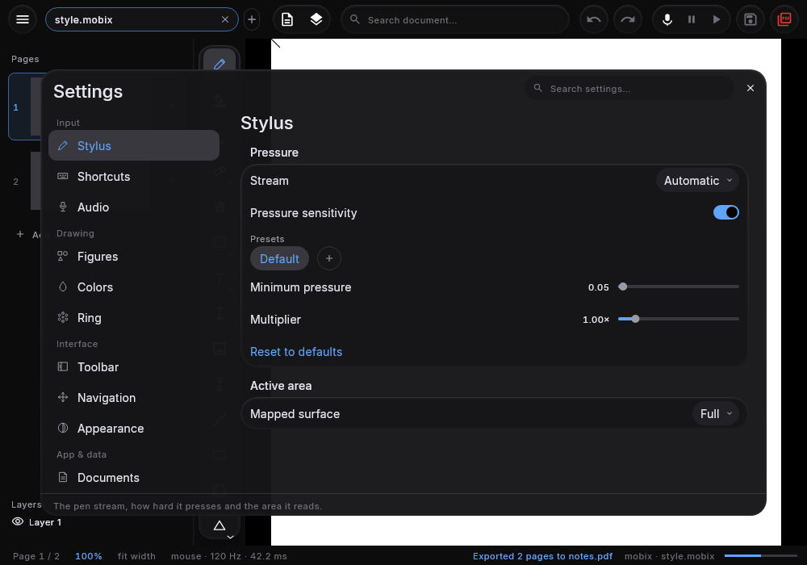

# MobiXournal Desktop v1.0.1 (Windows 11)

Released 2026-11-07 · the window's first follow-up to the 1.0.0 that shipped with MobiXournal 2.0.0:
what the page does when you scroll it, what the zoom percentage means, and a status band that explains
itself instead of reporting in the language of a profiler.

  

---

## 🔍 Zoom measured in the page, not in pixels

- **100 % is the page's width.** The scale that fills the window with the sheet is now what the percentage
  reads as 100 %, so "fit the width" and "100 %" are the same number instead of two that drifted apart at
  every window size. New documents open on it (`FitOnOpen` still offers auto, whole page and free).
- **The limits are relative too.** The ends are 25 % and 3 200 % *of the width fit*, so the ceiling and the
  floor mean the same thing on a laptop and on a 21:9 desk — they used to be absolute scales that a wide
  monitor turned into a different range.
- **The percentage is a way back.** Clicking the zoom readout returns the page to 100 % (the same command as
  `Ctrl + 1`), which is the gesture a reader reaches for after a stray scroll.

## 🖱️ One scrolling rule, three inputs

- **Wheel, hand and pen share one distance.** Settings ▸ Scrolling's *Scroll distance* now governs the hand
  pan and the stylus, not only the wheel: the same document no longer moves by three different rules
  depending on how it was pushed.
- **A scroll into the edge says so.** Hitting a side flashes that edge of the sheet for a moment, so a
  clamp reads as "that is the end" rather than as a dropped input.
- **The hand pan stopped bouncing.** A drag moved the viewport from a press-time copy of the scale, so the
  page sprang back towards where the gesture began; each event now travels from the view as it is.
- **The pen pans in the Hand slot.** A contact that arrives with no primary-button bit set (Windows'
  emulated pen report) used to do nothing there; the slot's own pan now follows the contact.
- **A wheel glide ends when the hand takes over**, instead of writing its old target over the pan's first
  movement.

## 🎛️ A status band that explains itself

- **Short readings, plain words.** `Page 1 / 6 · 100 % · fit width · mouse · 120 Hz · 3.2 ms` replaces the
  diagnostics line (`pen:`, `ms frame`, `ms paint`).
- **Every reading has a tip.** Hovering says what the number is for — and the percentage says what its click
  does (`Back to 100 % · Ctrl + 1`).
- **The hamburger's panel sits under its glyph**, four dp away like every other header menu, instead of a
  whole control's height below it.

## ⚙️ Settings that stay in their own surface

- **A click on a Settings row no longer reaches the page.** Compose hands a press to every node under the
  pointer and the sheet reads presses it did not consume, so covering the page was never enough: dragging a
  slider also drew the line behind the panel. The surface now owns the pointer for as long as it is up, and
  the canvas carries no press handler while it does — the wheel follows the same rule.

- **Shortcuts belong to the window.** They were dispatched from the root of the composition, so any way of
  losing composition focus silenced the whole table — a text box that came and went left every shortcut dead
  until the page was clicked. The window now reads the key before the composition is asked.

## 📦 Installer

- **`MobiXournal-1.0.1.msi`** (74 MB): the same per-user WiX installer, no JVM needed on the target PC,
  optional `.mobix`/`.xopp` associations and desktop shortcut, under `%LOCALAPPDATA%`.
- **It replaces 1.0.0 in place** — the `UpgradeCode` is unchanged, so this is an upgrade and not a second
  copy of the app.
- **The app is named MobiXournal everywhere Windows asks for a name.** The launcher's file description was
  carrying the product's marketing sentence, and Windows reads that as the program's name in Task Manager and
  Explorer; it now reads `MobiXournal`, and the sentence stays where a description is asked for.
- The MSI is unsigned until signing material is configured (see `docs/tools.md`), so SmartScreen reports an
  unknown publisher.

**Full diff**: [`v2.0.0...desktop-v1.0.1`](https://github.com/amarzano2005/MobiXournal/compare/v2.0.0...desktop-v1.0.1)
