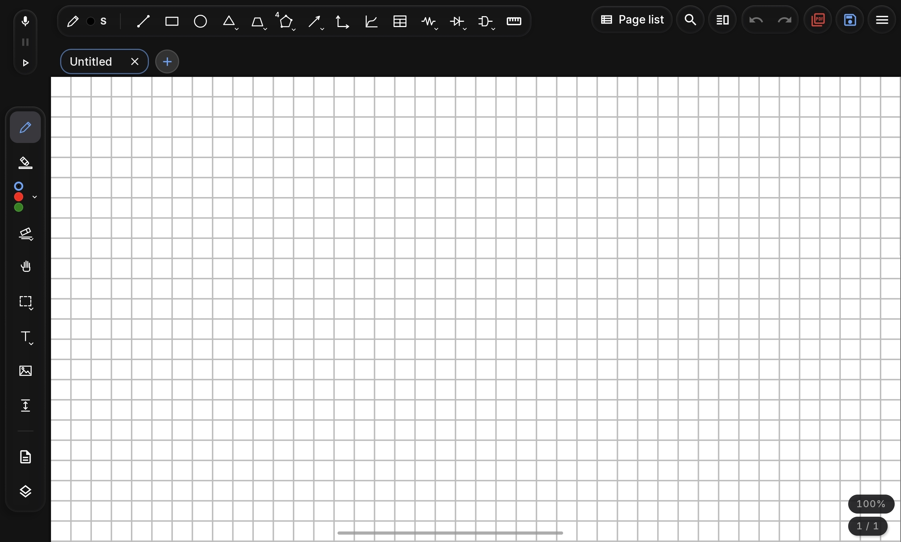
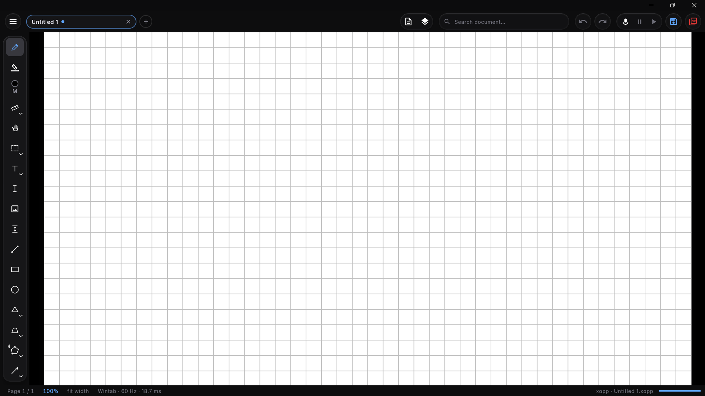

# MobiXournal v2.0.0 (Android) & Desktop v1.0.0 (Windows 11)

Released 2026-11-06 · **330 changes** across 303 features, 43 fixes, 32 refactors, 16 test suites, 5 documentation updates, and 5 maintenance improvements.

This milestone ships **two major releases together** over a single shared platform-free core (`mobix-core`):
- **MobiXournal v2.0.0 for Android (8.0+)**: A complete UI and architectural evolution featuring the frosted-glass interface system, paged `.mobix` ZIP streaming, self-contained Opus audio notes, on-device ML Kit handwriting search, and expanded STEM drafting tools.
- **MobiXournal Desktop v1.0.0 for Windows 11**: The inaugural native desktop workstation release (Compose Multiplatform on Skiko, packaged as a per-user WiX `.msi` installer with `.mobix`/`.xopp` file associations), engineered for graphics tablets (Wintab & Windows Ink), 21:9 ultrawide displays, and 120/144 Hz rendering.

  
    
  

---

## 🖥️ MobiXournal Desktop v1.0.0 for Windows 11

- **Native Windows 11 Workstation Shell**: True-black canvas desk with custom DWM dark title bar, frosted-glass header and floating tool capsules, multi-tab workspace, side-by-side split view (including live dual-pane mirrors of the same notebook), and a collapsible `Ctrl + B` page/layer/outline sidebar.
- **Three Configurable Tool Strip Layouts**: Place the tool capsule on the **Left rail**, **Right rail** (for left-handed writers), or **Top ribbon**, with customizable tool order and non-focus-stealing glass popups that preserve single-key shortcuts.
- **120/144 Hz Skia Picture Pipeline**: Records each page once into an immutable `PagePicture` base with incremental per-stroke tail pictures (`StrokePathCache`), making pan and zoom matrix replays sub-millisecond (`0.0–0.2 ms`) and stroke lifts proportional only to the newly drawn stroke.
- **Wintab, Windows Ink & Radial Dial Support**: Reads native pen pressure and tilt packets directly from Wintab or Windows Ink drivers without mouse-emulation artifacts, supports hardware radial dials and the on-canvas `Alt + B` pen-tip ring menu, and includes an interactive stylus pressure curve tester and named presets.
- **Per-User WiX MSI Installer (`MobiXournal-1.0.0.msi`)**: Self-contained Windows installer (no JVM required on target PC) with optional `.mobix` and `.xopp` Explorer file associations and desktop shortcut under `%LOCALAPPDATA%`.

---

## 📦 Native `.mobix` Engine & Lossless `.xopp` Bridge

- **Paged PKWARE ZIP `.mobix` Container**: Part-per-page lazy streaming (`MobixPagedReader` / `PageWindow`), incremental delta-saves (`MobixIncrementalSaver`) that rewrite only modified pages in milliseconds, content-addressed `assets/` deduplication, and atomic staged writes safe for Google Drive, Nextcloud, OneDrive, and WebDAV.
- **Sticky Per-Document Format Policy**: Opened `.xopp` notebooks save back as `.xopp` and opened `.mobix` notebooks save back as `.mobix`; **Save As** explicitly converts in either direction between `.mobix`, standard `.xopp`, and self-contained ZIP `.xopp`.
- **Lossless `XoppSynthesis` & `MobixMetaRevival` Bridge**: Compiles living STEM entities into standard `.xopp` vector ink and text boxes through the unified `LivingInk` renderer with SHA-256 verified metadata comments, reviving them as editable entities when reopened unless modified in desktop Xournal++.

---

## 🔬 Living STEM & Technical Drafting Suite

- **Living 2D Function Plotter**: Cartesian $y = f(x)$ and parametric $\{x(t), y(t)\}$ plots with multiple expressions, live calculus overlays (roots, extrema, inflection points, tangent lines, shaded definite integrals $\int_a^b f(x)\,dx$), and interactive on-canvas parameter sliders ($a, b, c, k$).
- **Electronic Circuits & IEEE Logic Gates**: Full schematic placement and in-place editing for passive/active components (resistors, capacitors, inductors, diodes, LEDs, BJTs, op-amps, DC/AC sources, switches, ground/VCC) and IEEE/ANSI digital logic gates (`AND`, `OR`, `NOT`, `NAND`, `NOR`, `XOR`, `XNOR`) with magnetic pin snapping and wire-end joining.
- **Chemistry, Tables & Math Blocks**: 60°/120° chemical bond lattice with single/double/triple bonds and aromatic benzene rings, resizable relational data tables with in-place cell editing, and re-editable LaTeX / Typst math formulas rendered to crisp vectors.
- **Virtual Drafting Instruments & Hold-to-Snap**: On-canvas interactive setsquare, compass, and protractor guides, isometric/graph/ruled/dotted paper snapping, and 300 ms pen-dwell shape recognition into clean lines, arrows, arcs, circles, rectangles, triangles, and regular polygons.

---

## 🎙️ Synchronized Audio, Smart PDF & Handwriting Search

- **Stroke-Synchronized Audio Recording & Karaoke Playback**: Record compressed Ogg Opus audio bundled directly inside `.mobix` (or WAV sidecars on Windows) while writing; tap any stroke with **Audio Tap / Play Object** or scrub the waveform player ($0.8\times\text{–}2.0\times$ speed) to watch the page's ink replay stroke-by-stroke in sync with the recording.
- **Full-Featured PDF Annotation & Page Management**: Import full PDFs or custom page ranges, select and copy real PDF text (`Shift + S`), snap highlighters magnetically to PDF text lines, navigate hierarchical PDF outlines, and reorder, duplicate, or copy/paste pages across tabs.
- **Unified Handwriting & Full-Text Search**: Search typed text, math source, PDF text layers, and handwritten ink simultaneously using Google ML Kit Digital Ink on Android, Windows Ink recognition on PC, and an offline Kotlin recognizer with per-line ink caching.
- **11-Section Unified Settings & Instant Search**: Shared frosted-glass Settings dialog across Android and Windows with instant keyword and shortcut filtering, custom color palettes, per-tool ink memory (separate pen and highlighter colors, widths, patterns, and 3 favorites), and crash-recovery snapshots.

---

## 📥 Downloads

| Platform | Asset | Version | Notes |
|---|---|---|---|
| **Android 8.0+ (API 26+)** | `app-release.apk` | `v2.0.0` (`versionCode 14`) | Release-optimized APK; installs/upgrades `com.mobixournal` on Android tablets & phones |
| **Windows 11 (x64)** | `MobiXournal-1.0.0.msi` | `v1.0.0` | Self-contained per-user installer with `.mobix` & `.xopp` associations |

---

**Full diff**: [`v1.3.0...v2.0.0`](https://github.com/amarzano2005/MobiXournal/compare/v1.3.0...v2.0.0)
